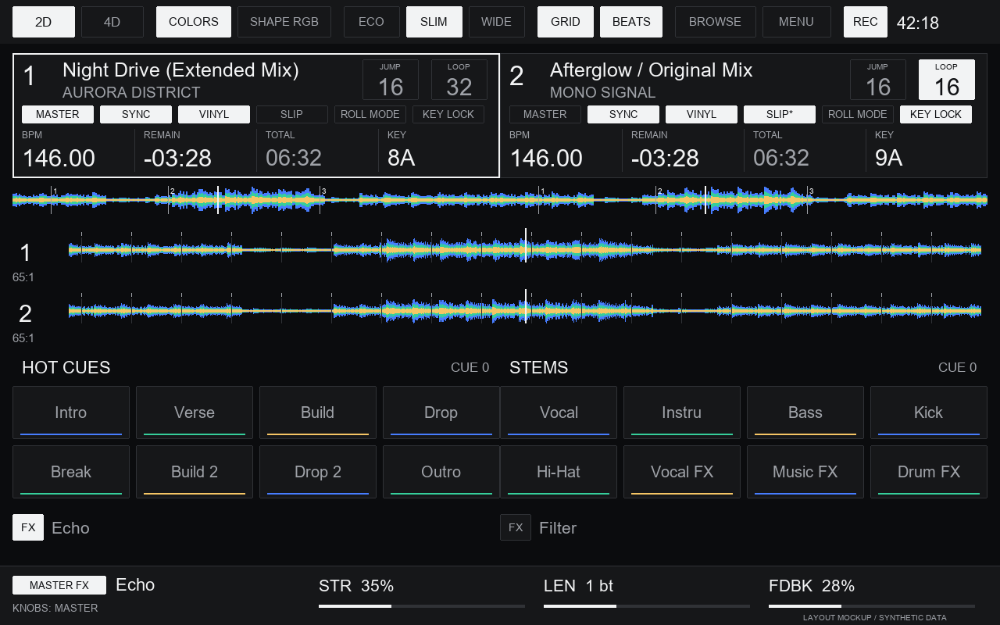

<p align="center">
  
</p>

<p align="center">Alternative and lightweight skin for Denon SC Live 4</p>

## Why I made it

With the stock skin, playing two tracks with colored waveforms could bring my
SC Live 4's screen down to something like 5 FPS. The waves stuttered and the
screen became slow to respond. Disabling album artwork helped a little, but
changing the ASIO buffer and using a shorter USB cable didn't fix it.

Monochrome Shape waveforms ran better, but I rely on colors to recognise parts
of a track. Giving that up made the screen much less useful to me.

I mostly mix on two decks and still glance at the computer monitor. What I
wanted on the controller was straightforward: colored waveforms, a track
overview, readable track information and labels showing what the pads do.
Wendy grew out of trying to keep those things useful while making the screen
less sluggish.



*This is an approximate mockup and does not reproduce the device screen exactly.
The skin's appearance may vary between devices and software versions.*

## What's on screen

- Two-deck and four-deck views, with ECO, SLIM and WIDE waveforms.
- Colored waveforms and RGB Shapes, an optional beat grid and bar/beat counter.
  Tap the track overview to seek.
- Track title, artist, key, BPM with two decimal places, and remaining or elapsed
  time. The second time field switches between total length and remaining time.
- Eight pads per deck, with labels for the pad page selected on the controller.
- Deck status and controls, including master selection, Sync, Vinyl, Slip,
  Roll Mode and Key Lock in the two-deck view.
- Loop and Beat Jump sizes that increase when tapped and wrap back to the start.
- Track FX names and status. Tap **FX** to choose the next effect; this turns off
  the previous effect in that slot. Master FX and their parameters stay visible
  at the bottom.
- A recording indicator and timer, a browser showing the loaded tracks, and
  dark and light themes.

The settings menu covers the waveform display, touch controls and a few useful
VirtualDJ options. Some of those options also affect the computer skin.

## How it runs

During development, I was seeing roughly 25-30 FPS with two colored tracks
playing, including around 30 FPS on particularly busy waveforms. That's judging
by eye on my setup. Dense, colorful tracks can still slow the screen down.

ECO and SLIM keep the waveforms compact. WIDE gives them more room, so you can pick
what feels best while mixing. I have used the skin on a real SC Live 4 with
VirtualDJ build 8472 and worked through the controls over several revisions.
There are more details in the [development notes](docs/DEVELOPMENT.md).

## Install

1. Download **`Denon SCLIVE4 Screen.zip`** from this repository's Releases page.
   Choose that asset rather than GitHub's automatic "Source code" download.
2. Close VirtualDJ and back up the screen skin you currently use.
3. Open the `Skins` folder in your VirtualDJ home directory. On my Windows setup
   this is `%LOCALAPPDATA%\VirtualDJ\Skins`.
4. Put the new ZIP there. If you also have an unpacked `Denon SCLIVE4 Screen`
   folder, move it to your backup location outside `Skins` so it doesn't override
   the new file.
5. Start VirtualDJ with the SC Live 4 in computer mode.

Keep the ZIP's filename as it is. VirtualDJ expects the original screen name,
so the file is called `Denon SCLIVE4 Screen.zip` even though the project is Wendy.

To go back to your previous skin, close VirtualDJ and restore your backup.

## Build it yourself

You'll need Python 3.10 or newer. There are no extra Python packages to install.
From the repository root, run:

```sh
python tools/build.py
```

The installable ZIP will be in `dist/`, along with `SHA256SUMS`, a build report
and an unpacked copy of the skin. The build works on Windows, Linux and macOS;
Windows and Linux builds were checked during this export and produced the
same ZIP.

To change the layout or controls, edit [src/skin.py](src/skin.py). The XML in
`dist/` is generated from that file and the native dialogs in `src/dialogs.xml`.
The sprite sheet and system dialogs come from the supplied stock skin; their
provenance is recorded in [NOTICE.md](NOTICE.md).

## Publish a release

Put the contents of this directory at the root of your GitHub repository,
including `.github`. Once the files are committed and pushed, tagging a version
will run the build and publish a release automatically:

```sh
git tag -a v2.5.3 -m "Wendy 2.5.3"
git push origin v2.5.3
```

For the next release, update `VERSION`, commit it and push the matching tag.
For example, `VERSION` containing `2.6.0` goes with tag `v2.6.0`.

The workflow attaches the skin ZIP, its checksum and the build report to the
release. It uses GitHub's built-in token, so you don't need to add a personal
access token. A tag such as `v2.6.0-rc.1` creates a prerelease.

You can also run it from the Actions tab with an existing tag. Details about
manual runs, retries and version checks are in the
[development notes](docs/DEVELOPMENT.md#releases).

## AI disclosure

I developed Wendy with substantial help from **OpenAI Codex**, including the
code, research, documentation and build workflow. I set the requirements,
tested the skin on my controller and used those results to guide the revisions.
The full [AI disclosure](AI_DISCLOSURE.md) explains that collaboration and what
was checked.
